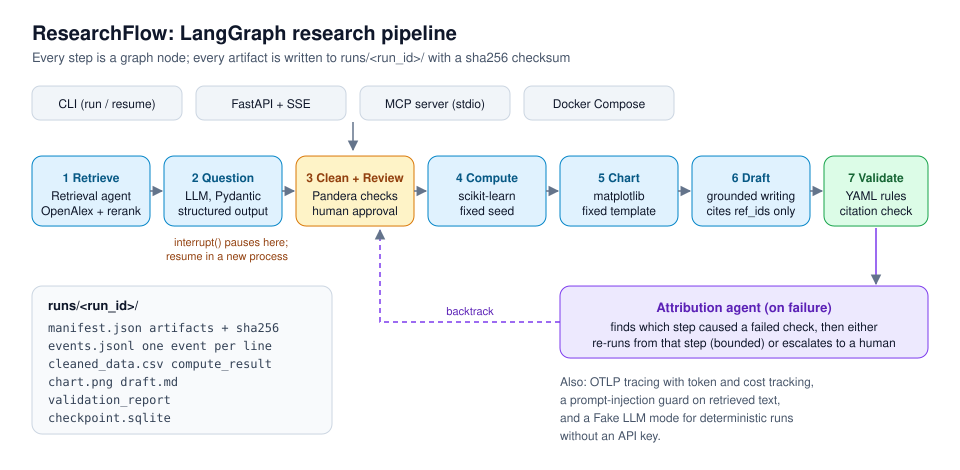

# ResearchFlow

**An auditable LLM agent pipeline that takes a research topic from literature search to a validated draft, with a human approval step, self-diagnosis on failure, and a checksum on every output.**



## What it does

ResearchFlow is a [LangGraph](https://github.com/langchain-ai/langgraph) state graph with seven steps:

1. **Retrieve.** A retrieval agent rewrites the topic into search queries, searches [OpenAlex](https://openalex.org) (or a local corpus), and picks the most relevant papers. An optional hybrid reranker (BM25 + embeddings, fused with RRF or an adaptive weighting) scores all candidates.
2. **Frame the question.** An LLM turns the topic and papers into a structured research question, validated with Pydantic.
3. **Clean and review the data.** Cleaning, then hard-threshold checks with Pandera, then a **human-in-the-loop pause** (`interrupt()`). A reviewer approves or rejects in the CLI or over HTTP. The approval is bound to the sha256 of the exact file reviewed, so if the data changes while the run is paused, the run stops instead of using unreviewed data.
4. **Compute.** A scikit-learn model with a fixed seed, so results are reproducible.
5. **Chart.** A matplotlib figure from a fixed template.
6. **Draft.** A Markdown draft written by the LLM and rendered with Jinja2. The draft may only cite papers that were actually retrieved, referenced by `ref_id`.
7. **Validate.** A YAML rule engine checks metrics, required sections, artifacts, placeholders, sample size, and citations. Citations to papers that were not retrieved are blocked.

When a check fails, an **attribution agent** works out which earlier step caused it. It then either re-runs the pipeline from that step (with a retry limit) or hands the run to a human if the data cannot be fixed.

Production details:

- **Four ways to run it:** CLI, a FastAPI service with Server-Sent Events, an MCP server (for Claude Desktop, Cursor, and other MCP clients), and Docker Compose.
- **Resume after a crash or restart.** Each run has its own SQLite checkpoint, so a run paused for review can be resumed in a new process.
- **Audit trail.** Every run writes `manifest.json` (all artifacts with sha256 checksums) and `events.jsonl` (one event per line). The same input gives byte-identical artifacts in any directory.
- **Observability.** Tracing with OTLP export, plus per-step token counts and cost.
- **Prompt-injection guard.** Retrieved abstracts are treated as untrusted data, and instruction-like text is flagged.
- **Runs without an API key.** With no key, a deterministic Fake LLM adapter runs the whole pipeline. CI uses it, so tests cost nothing.

## Results

All numbers come from the evaluation reports in [`docs/reviews/`](docs/reviews/) and [`evals/`](evals/). Each is a single run judged by LLMs, and each report states its sample size and limitations.

| What was measured | Result | Report |
| --- | --- | --- |
| Retrieval agent vs. keyword search, 20 hard topics (Precision@5) | **0.31 → 0.93**, better on 18 of 20 topics | [retrieval-eval](docs/reviews/gate2/retrieval-eval-20261013.md) |
| Retrieval agent vs. keyword search, 20 easy topics (Precision@5) | 0.83 → 0.87 (not significant) | same |
| Offline reranking, hard topics: adaptive fusion + agent-rewritten queries | Precision@5 **0.96**, Recall@10 **0.93** (BM25 alone: P@5 0.34) | [rerank-eval](docs/reviews/gate3/rerank-eval-20261017.md) |
| Attribution agent on a fault-injection test set | fixable faults repaired **13/13**, unfixable ones escalated **11/11**, 0 wasted re-runs | [attribution-eval](docs/reviews/gate2/attribution-eval-20261010.md) |
| Citation check against fabricated / injected citations | **100%** blocked, **0%** false rejections | [citation-eval](docs/reviews/gate3/citation-eval-20261016.md) |
| Hallucinated citations before the check, 20 real topics | **0 / 118** | same |
| Citation support (two independent LLM judges) | 90.9% strict, 100% lenient, κ = 0.88 | same |
| Prompt injection, 12 attack types × 5 runs | 0/60 successful attacks; the guard cut how often the poisoned paper was selected from 53% to 25% | [injection-eval](docs/reviews/gate3/injection-eval-20261017.md) |

The test suite has 500+ pytest tests. CI also runs ruff, mypy, a `uv.lock` check, and a Docker smoke test.

## Tech stack

- **Agent and orchestration:** LangGraph (state graph, `interrupt` / `Command(resume=...)`, SQLite checkpointer), OpenAI-compatible tool calling, strict JSON-schema structured output
- **Retrieval:** OpenAlex API, BM25, embeddings, RRF and adaptive fusion, multi-query rewriting
- **Data and compute:** pandas, Pandera, scikit-learn, matplotlib, Jinja2
- **Interfaces:** FastAPI + SSE, uvicorn, MCP (stdio), Docker Compose
- **Quality:** Pydantic v2 contracts, pytest, ruff, mypy, GitHub Actions, uv with a locked `uv.lock`
- **Python** 3.11

## How to run it

Requires [uv](https://docs.astral.sh/uv/). uv installs Python 3.11 for you.

```bash
git clone https://github.com/hkban99668-code/researchflow.git
cd researchflow
uv sync --locked

# Full pipeline. Without an API key it uses the Fake LLM, so no key is needed.
uv run researchflow run --topic examples/demo_topic.yaml
```

The run pauses at step 3 and asks you to type `approve` or `reject`. Outputs go to `runs/<run_id>/`.

**With a real model:** copy `.env.example` to `.env` and set `RF_LLM_BASE_URL`, `RF_LLM_API_KEY` and `RF_LLM_MODEL` (any OpenAI-compatible endpoint).

**Other entry points:**

```bash
uv run researchflow serve                 # HTTP API + SSE on 127.0.0.1:8000
uv run researchflow mcp                   # MCP server over stdio (read-only tools)
uv run researchflow mcp --allow-exec      # also expose tools that start runs
docker compose up -d                      # API in a container, no key needed
docker compose --profile demo run --rm demo   # one full demo run in a container
```

**Tests:**

```bash
uv run pytest -q
uv run ruff check . && uv run mypy
```

> The HTTP service has no authentication and binds to `127.0.0.1` by default. Do not expose it to the public internet as is.

Full technical documentation (configuration, module reference, exit codes, evaluation commands) is in [README.zh-CN.md](README.zh-CN.md), written in Chinese.

## License

No license file yet. Contact the author before reusing the code.
